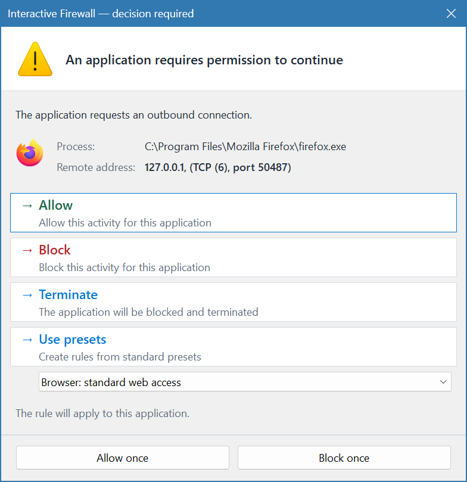
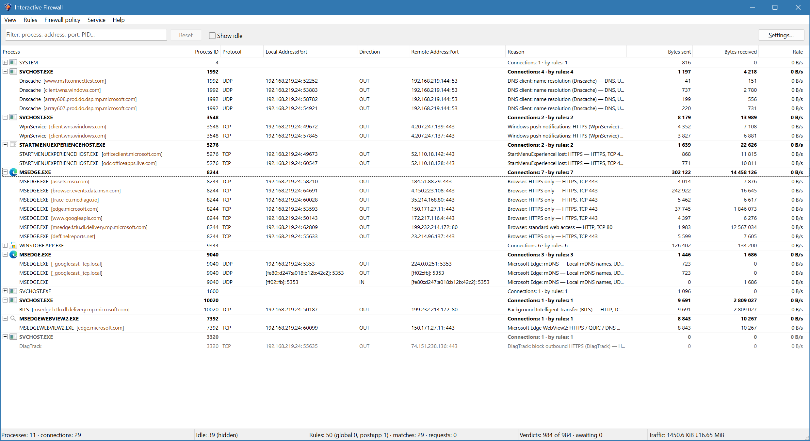
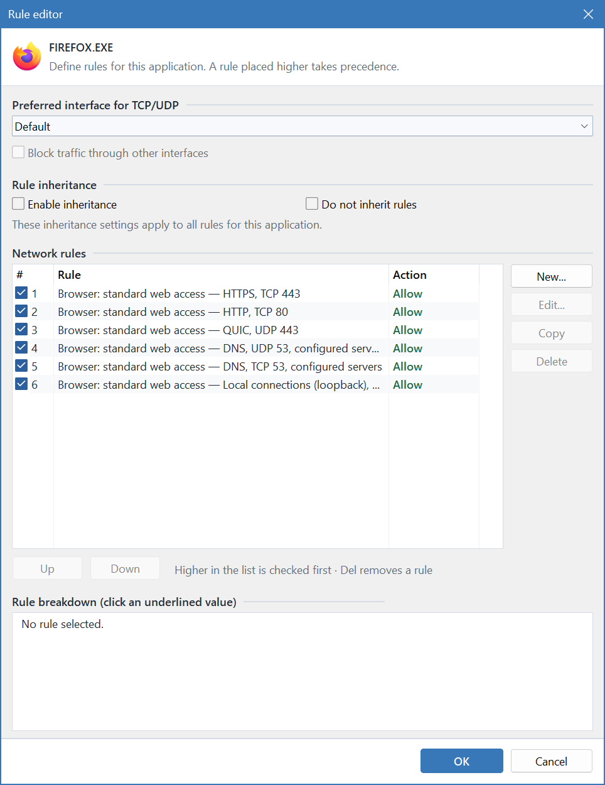
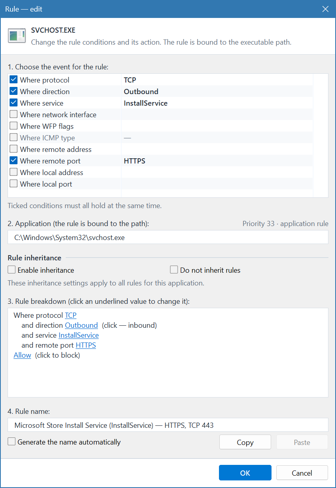
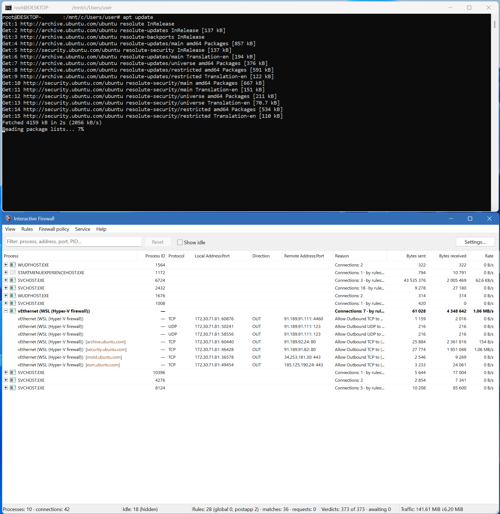

# Interactive Firewall

**English** | [Русский](README.ru.md)


[](LICENSE)

**A personal firewall for Windows 11 Enterprise 26H2+**

Interactive Firewall shows which applications access the network, where they
connect, and how much data they transfer. Allow or block connections, respond to
requests from new applications, and create your own access rules. The program
supports IPv4 and IPv6 and can also filter transit packets on compatible
physical and virtual Ethernet adapters, including suitable Hyper-V, WSL, and
Windows Sandbox adapters.

[Features](#features) · [Screenshots](#screenshots) ·
[Firewall modes](#firewall-modes) · [Drivers](#drivers) ·
[Requirements and running](#requirements-and-running) ·
[Building from source](#building-from-source) · [License](#license)

## Features

### Network monitoring

- A real-time connection list grouped by process.
- Local and remote addresses, ports, protocol, connection direction, and PID.
- Data sent and received, transfer rates, and total traffic counters.
- Domain names when they can be determined from DNS, mDNS, LLMNR, HTTP, or
  SNI in TLS and QUIC connections.
- Information on whether a connection was allowed or blocked and which rule matched.
- Search by process, path, domain, address, port, protocol, and PID; sorting and
  display of idle connections.
- Copy a selected row or all displayed rows, terminate a process, and close
  eligible IPv4 TCP connections. Closing IPv6 TCP connections and listening
  sockets is not supported.

### Flexible access rules

- **Application rules** — individual permissions and blocks for programs.
- **Global rules** — a general policy for the host's network activity.
- **Interface rules** — separate rule sets for selected network adapters.
- **Post-application rules** — additional rules checked last.
- Conditions based on direction, IP protocol, IPv4/IPv6 addresses and subnets,
  local and remote ports, ICMP types, Windows services, and network interface.
  Service names support the `*` wildcard, for example `WpnUserService_*`.
- An additional condition based on WFP flags for host events: a rule matches if
  all selected flags are present. This condition does not match
  FirewallXNdisFilter traffic or events without this data.
- Port ranges and dynamic address groups: DNS servers, gateways, the local
  network, the computer's addresses, broadcast addresses, and multicast addresses.
- Configurable inheritance of parent application rules by child processes.
- Preset rule sets. Suitable sets are suggested based on the application,
  service, and event. **Rules → Generate rules from templates** creates rules
  for signed programs and services found on the computer, as well as system IGMP traffic.
- Edit, copy, enable, and disable rules, change their priority, and clean up
  rules for applications that no longer exist.

For host traffic, interface rules are checked first, followed by global rules,
application rules, and post-application rules. If no rule matches, the selected
firewall mode applies.

### Preferred application interface

In the application rule editor, you can select a preferred interface for new
TCP/UDP connections over IPv4 and IPv6. If the selected interface is unavailable
or cannot be applied, the application's network activity is blocked, including
in **Allow all** mode. The setting applies to all instances of an application
with the same EXE path and can change Windows routing policies. When blocking
other interfaces is enabled, loopback traffic is treated as an exception.

The additional **Block traffic through other interfaces** option also blocks
activity through other or unidentified interfaces. Loopback traffic is handled
according to the selected policy and rules. These settings apply to host
applications, not to FirewallXNdisFilter transit traffic.

### Interactive control

In learning mode, the program asks you to decide what to do with new network
activity: allow it, block it, or use a preset rule set. You can respond once
without creating a permanent rule, or save the decision for the application.
You can also block the activity and terminate the application. If the
connection's owner cannot be identified unambiguously or the executable path
of a regular process is unavailable, activity without a matching rule is
blocked without a prompt.



### Automatic rule creation

You can enable **Automatic rule creation** in the settings; it is disabled by
default. It works only in learning mode while the graphical interface is
running. When only the service is running and the graphical interface is not
connected, automatic rule creation does not run.

The program automatically applies the first matching rule set to a file with a
trusted digital signature. A set can contain both allow and block rules. If
automatic selection is not possible, the pending request is presented to the
user.

Signature verification does not guarantee that an application is safe and does
not perform an online certificate revocation check.

### Background operation and interface

- Minimise to the system tray and access pending requests, rules, and firewall
  modes from the tray icon menu. Closing the main window minimises the program
  to the tray; use **Exit** to quit.
- Start automatically when signing in to Windows.
- An optional Windows service continues filtering according to saved rules and
  the selected policy when the graphical interface is not running.
- A settings window for WFP events and auditing, Windows Firewall, more precise
  UDP traffic direction detection, and request sounds. Some of these switches
  change system-wide Windows settings.
- Modern styling and a classic table, separate font settings for each style,
  column order, and system scaling.
- Additional protection for the program process against third-party DLL
  injection. Attribution settings may require restarting the program or service;
  scaling and protection changes require restarting the program.
- Rules and settings are preserved between runs.
- **34 interface language variants:** Russian, English, Korean, Chinese
  (Simplified and Traditional), Ukrainian, German, French, Spanish, Arabic,
  Hindi, Latvian, Lithuanian, Estonian, Romanian, Swedish, Polish, Vietnamese,
  Portuguese (Portugal and Brazil), Italian, Persian, Japanese, Turkish,
  Indonesian, Czech, Thai, Hungarian, Greek, Dutch, Bulgarian, Danish,
  Norwegian Bokmål, and Finnish. Select the language under **View → Language**.
  Russian is used by default on Russian-language Windows; English is used on
  other Windows installations.

## Screenshots

The screenshots show the program's English interface.

### Main window and connection monitoring



### Application rules



### Editing an individual rule



### WSL traffic monitoring



## Firewall modes

| Mode | Behaviour |
| --- | --- |
| **Block all** | Blocks network connections regardless of rules, except local traffic within this computer unless blocked by the application interface setting. |
| **Block mode** | Allows only connections explicitly permitted by rules. |
| **Learning mode** | Applies rules; for new activity without a matching rule, asks for a decision or automatically creates rules if that setting is enabled. Selected by default. |
| **Allow mode** | Allows connections unless prohibited by rules. |
| **Allow all** | Allows connections regardless of rules, except for blocks associated with the application's preferred interface. |

Change the mode using the **Firewall policy** menu. In learning mode, certain
service ICMP/ICMPv6 messages are allowed automatically when no rule matches.
Application preferred-interface restrictions are checked before the selected
policy, including in **Allow all** mode.

In learning mode, when only the service is running and the graphical interface
is not connected, unknown activity without a matching rule is blocked rather
than prompting the user; the automatic exceptions for service messages remain
in effect.

## Drivers

The program uses two drivers for different purposes:

| Driver | Purpose | Setup |
| --- | --- | --- |
| [Modified Portmaster Windows Kernel Extension](https://github.com/GerardoKermitToy/windows_kext_mod) | The main WFP-based Windows network traffic filtering driver. Associates connections with processes, applies allow and block decisions, and accounts for IPv4/IPv6 traffic. | Place `portmaster-kext.sys` next to `FirewallX.exe`; the program manages loading it. |
| [FirewallXNdisFilter](https://github.com/GerardoKermitToy/FirewallXNdisFilter) | An optional NDIS filter for transit IPv4/IPv6 traffic on compatible physical and virtual Ethernet adapters. | Install separately using the complete driver package. |

**The main driver requires a compatible modified build from the project linked
above.** The original Portmaster driver is not a substitute. Both drivers must
be signed and allowed to load by your Windows system; building the application
does not sign or install them.

> [!IMPORTANT]
> **The Portmaster and FirewallXNdisFilter drivers do not have a Microsoft digital signature.**
> Instructions for preparing the system and enabling the drivers with
> **Secure Boot** enabled are available in the
> [windows_kext_mod repository](https://github.com/GerardoKermitToy/windows_kext_mod).
> Review the requirements and precautions in those instructions before changing
> your configuration.

### Hyper-V, WSL, and transit traffic

FirewallXNdisFilter filters transit IPv4/IPv6 traffic on compatible physical
and virtual Ethernet adapters, including suitable Hyper-V, WSL, and Windows
Sandbox adapters. WireGuard/Wintun adapters are not supported; visibility into
traffic between virtual machines is not guaranteed. Applications inside guest
systems and the association of traffic with a particular virtual machine are
not identified.

For this traffic, the rules for the relevant interface and the selected firewall
mode apply, but global rules, host application rules, and post-application
rules do not. A packet can be counted more than once if it passes through
multiple connected adapters.

In the interface rule editor, you can select **Do not filter transit packets on
this interface**. When the setting is applied successfully, the driver is
disabled only on the selected adapter; the same packet can still be filtered
on another connected adapter. Rules for host applications continue to apply.
Changing the network configuration can briefly interrupt connectivity.

> [!IMPORTANT]
> Packets with a local host address, packets to multicast or broadcast addresses,
> and certain DHCP replies are not subject to FirewallXNdisFilter transit rules
> and are not counted by it. Transit filtering may be temporarily unavailable
> while address information is being updated.

> [!WARNING]
> FirewallXNdisFilter is an experimental driver. When the filter is installed
> and active, the absence of a connected controller blocks transit IP traffic
> subject to the policy by default, including Internet connection sharing.
> Local addresses and the bypass cases described above are exceptions. Exiting
> the program does not remove this driver. Review its project's instructions
> before installation.

Build, signing, and installation instructions are available in the driver
projects: [Portmaster](https://github.com/GerardoKermitToy/windows_kext_mod#building-and-testing)
and [FirewallXNdisFilter](https://github.com/GerardoKermitToy/FirewallXNdisFilter#build).

## Requirements and running

- **OS: Windows 11 Enterprise 26H2, x64.**
- **Processor: x64 with SSE 4.2 support.**
- **Administrator privileges** to run the program and manage filtering.
- A compatible main `portmaster-kext.sys` driver.
- [Microsoft Visual C++ Redistributable x64](https://learn.microsoft.com/cpp/windows/latest-supported-vc-redist)
  to run MSVC builds if the runtime is not already installed.
- For optional transit traffic filtering, a separately installed compatible
  FirewallXNdisFilter package.

1. Build the application using the instructions below.
2. Place a compatible `portmaster-kext.sys` in the same folder as `FirewallX.exe`.
3. Run `FirewallX.exe` **as administrator**.
4. Select a firewall mode. For initial setup, use **Learning mode** and preset
   rule sets.
5. To filter without keeping the program open, install the service from the
   **Service → Install service** menu, then select **Service → Start service**
   to start it immediately. Installation configures the service to start
   automatically with Windows. Minimising to the tray does not require the service.

The program's rules and settings are stored in `settings.db` next to the
executable. Keep this file when moving or backing up the program. Some settings,
including automatic startup, WFP auditing and events, Windows Firewall, and
routing policies, are stored or applied in Windows itself and are not transferred
by copying the database alone.

### Testing in a virtual machine

For testing in an isolated virtual machine, you can enable test-signing mode
for drivers and add the root certificate to the guest Windows trusted store.
Creating a virtual machine snapshot before changing settings is recommended.

Ensure that `localhost-root-ca.der` is the trusted root certificate in the
signing chain of the test drivers being used, and place the file in the current
directory inside the virtual machine. Certificate creation is described in the
[Portmaster driver instructions](https://github.com/GerardoKermitToy/windows_kext_mod#building-and-testing).
Open PowerShell **as administrator in the guest Windows system** and run:

```powershell
bcdedit.exe -set TESTSIGNING ON
```

```powershell
certutil -addstore -f "Root" localhost-root-ca.der
```

Then restart the guest Windows system. These commands do not sign or install
drivers: use drivers signed with a certificate from the corresponding chain.

> [!WARNING]
> Test-signing mode relaxes driver signature verification, and adding a root
> certificate extends system trust to certificates issued by that authority.
> Use only a verified certificate and limit these settings to a test virtual
> machine. With Secure Boot enabled, Windows policy may prevent `TESTSIGNING`
> from being enabled; the Secure Boot requirements and precautions are described
> in the driver instructions.

## Building from source

### Prerequisites

- **Visual Studio 2026** or the corresponding Build Tools with the
  **Desktop development with C++** workload, an MSVC x64 compiler with C++20
  support, and the Windows SDK.
- **CMake 4.2 or later**, available in `PATH`. This version is required for the
  Visual Studio 2026 generator used by the script.

Rust and the WDK are not required to build the application itself. The drivers
are built separately using the instructions in their repositories and are not
part of the FirewallX CMake build.

### Quick build

Open PowerShell in the repository root and run [build.bat](build.bat):

```bash
./build.bat
```

The script creates a Visual Studio project in the `build` directory and builds
the **Release x64** configuration. The resulting program is
**`build/Release/FirewallX.exe`**.

### Manual build

From the repository root, run:

```bash
cmake -S . -B build -G "Visual Studio 18 2026" -A x64
```

```bash
cmake --build build --config Release --parallel
```

The result is the same: `build/Release/FirewallX.exe`. After building, place the
main driver next to the EXE as described in the running section.

## Author and copyright

Author: ~~Claude Opus 5.5~~  [skrudjmdk](https://forum.ru-board.com/profile.cgi?action=show&member=skrudjmdk).

Copyright © 2026 skrudjmdk.

## License

The program is distributed under its own
[FirewallX Attribution License 1.0](LICENSE). The license text is provided in
English followed by Russian; the English version prevails in case of a
discrepancy. This is a separate license, not GPLv3. Files in the `flags/`
directory, including copies embedded in binaries or other files, are excluded
from this license; no rights in those files are claimed.

The code may be used, modified, and distributed in any lawful project, including
**commercial and closed-source projects**, without prior permission, license
fees, or mandatory royalties. This license does not require publication of the
source code of derived projects.

**Mandatory condition:** the graphical interface of every project using FirewallX
code must identify **skrudjmdk** as the author and include the repository
**https://github.com/GerardoKermitToy/FirewallX** — for example, in an accessible
“About”, “Credits”, or “Legal information” screen. A separately supplied product
without a graphical interface requires an accessible graphical attribution
page, such as a bundled HTML page. An entry only in source code or documentation
is not sufficient. Copyright notices and the full license text must also be
retained when redistributing the software.

Borrowing the code also requires recognizing as an author of FirewallX anyone
who proves possession of the private key corresponding to the certificate in
the license. Each such author receives a broad perpetual license to the
borrower's developments that form part of a project or product using FirewallX
code, including commercial and closed-source developments, to the extent the
borrower is entitled to license them. Developments outside such projects and
products are excluded. See the license for the detailed terms.

The program is provided “as is”, without warranties or support obligations.
The warranty disclaimer and limitation of liability apply to the extent
permitted by applicable law.

The Portmaster and FirewallXNdisFilter drivers are distributed separately
under GPLv3; the new license does not apply to them. Third-party component
licenses remain in effect, including any applicable source disclosure
obligations.
