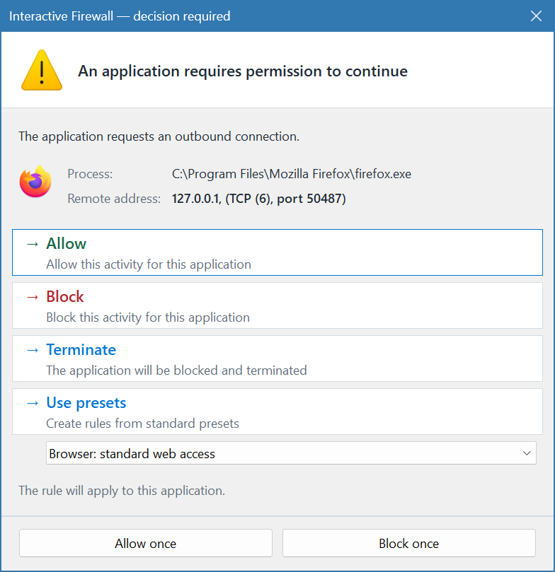
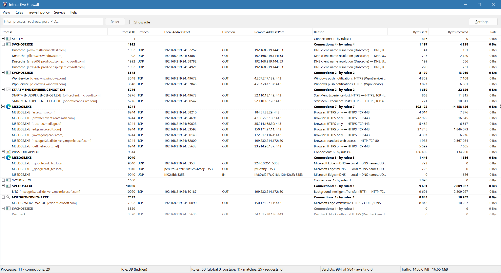
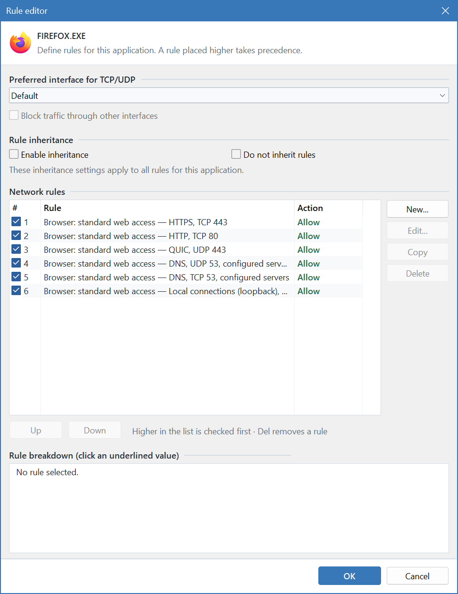
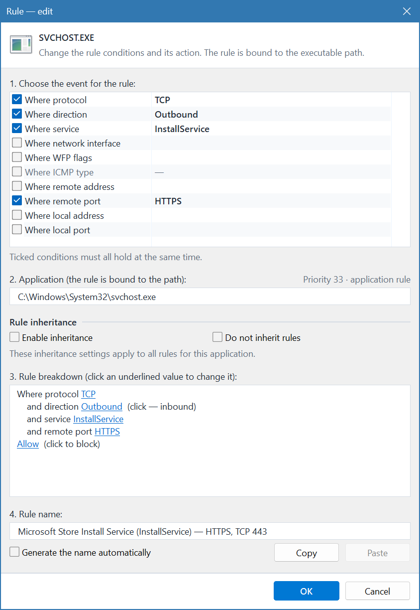
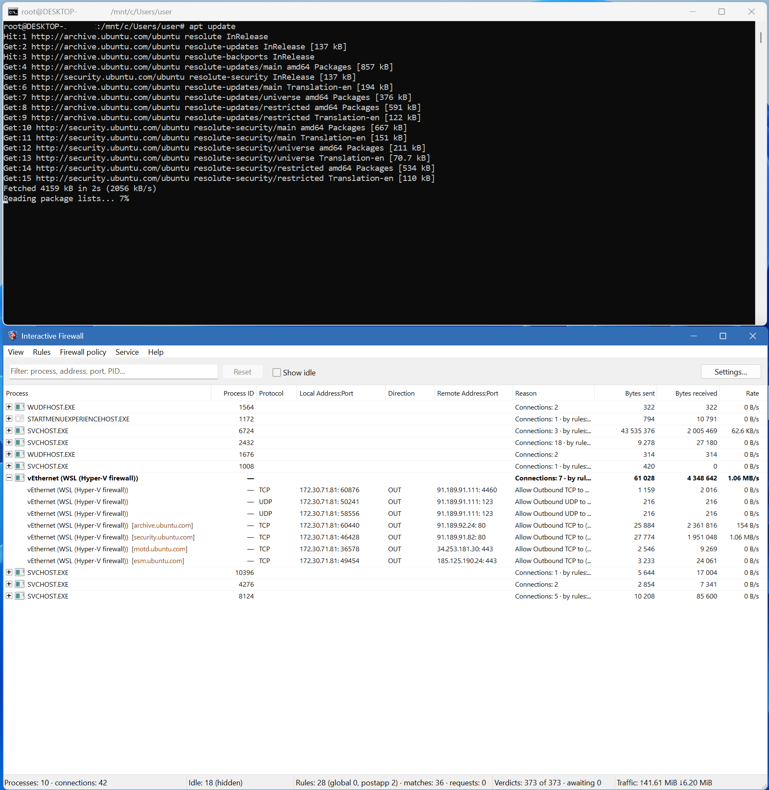

# Interactive Firewall

[English](README.md) | **Русский**


[](LICENSE)

**Персональный брандмауэр для Windows 11 Enterprise 26H2+**

Interactive Firewall показывает, какие приложения обращаются к сети, куда они
подключаются и сколько данных передают. Разрешайте или блокируйте соединения,
отвечайте на запросы новых приложений и создавайте собственные правила доступа.
Программа работает с IPv4 и IPv6 и поддерживает дополнительную фильтрацию
транзитных пакетов через совместимые физические и виртуальные Ethernet-адаптеры,
в том числе через подходящие адаптеры Hyper-V, WSL и Windows Sandbox.

[Возможности](#возможности) · [Скриншоты](#скриншоты) ·
[Режимы работы](#режимы-работы) · [Драйверы](#используемые-драйверы) ·
[Запуск](#требования-и-запуск) · [Сборка](#сборка-из-исходников) ·
[Лицензия](#лицензия)

## Возможности

### Мониторинг сети

- Список соединений в реальном времени с группировкой по процессам.
- Локальные и удалённые адреса, порты, протокол, направление соединения и PID.
- Объём отправленных и полученных данных, скорость передачи и общие счётчики трафика.
- Отображение доменных имён, когда их удаётся определить по DNS, mDNS,
  LLMNR, HTTP или SNI в соединениях TLS и QUIC.
- Информация о разрешении или блокировке соединения и сработавшем правиле.
- Поиск по процессу, пути, домену, адресу, порту, протоколу и PID; сортировка
  и показ пассивных соединений.
- Копирование выбранной строки или всех отображаемых строк, завершение процесса
  и прерывание подходящих TCP-соединений IPv4. Прерывание TCP через IPv6 и
  прослушивающих сокетов не поддерживается.

### Гибкие правила доступа

- **Правила приложений** — индивидуальные разрешения и запреты для программ.
- **Глобальные правила** — общая политика для сетевой активности хоста.
- **Правила интерфейсов** — отдельные наборы для выбранных сетевых адаптеров.
- **Правила после приложений** — дополнительные правила, проверяемые последними.
- Условия по направлению, IP-протоколу, адресам и подсетям IPv4/IPv6,
  локальным и удалённым портам, типам ICMP, службам Windows и сетевому интерфейсу.
  В именах служб поддерживается маска `*`, например `WpnUserService_*`.
- Дополнительное условие по признакам WFP для событий хоста: правило совпадает,
  если присутствуют все выбранные признаки. Для трафика FirewallXNdisFilter
  и событий без этих данных такое условие не совпадает.
- Диапазоны портов и динамические группы адресов: DNS-серверы, шлюзы,
  локальная сеть, адреса компьютера, широковещательные и групповые адреса.
- Настраиваемое наследование правил родительского приложения дочерними процессами.
- Готовые наборы правил предлагаются с учётом приложения, службы и события.
  Команда **Правила → Создать правила по шаблонам** создаёт правила для найденных
  подписанных программ и служб, а также для системного трафика IGMP.
- Редактирование, копирование, включение и отключение правил, изменение
  их приоритета и очистка правил для несуществующих приложений.

Для трафика хоста сначала проверяются правила интерфейса, затем глобальные
правила, правила приложения и правила после приложений. Если совпадения нет,
действует выбранный режим брандмауэра.

### Предпочтительный интерфейс приложения

В редакторе правил приложения можно выбрать предпочтительный интерфейс для новых
соединений TCP/UDP по IPv4 и IPv6. При недоступности выбранного интерфейса или
ошибке его применения сетевая активность приложения блокируется, в том числе
в режиме «Разрешать все». Настройка относится ко всем экземплярам приложения
с одним путём к EXE и может изменять политики маршрутизации Windows. При включённой
блокировке других интерфейсов трафик loopback составляет исключение.

Дополнительный параметр **«Блокировать трафик через другие интерфейсы»** блокирует
также активность через другие или неопределённые интерфейсы. Трафик loopback при
этом обрабатывается согласно выбранной политике и правилам. Эти настройки
относятся к приложениям хоста, а не к транзитному трафику FirewallXNdisFilter.

### Интерактивное управление

В режиме обучения программа предлагает принять решение о новой сетевой
активности: разрешить её, заблокировать или воспользоваться готовым набором
правил. Можно ответить однократно, не создавая постоянного правила,
либо сохранить решение для приложения. Также доступна блокировка с завершением
приложения. Если владелец соединения определён неоднозначно или путь к файлу
обычного процесса недоступен, активность без подходящего правила блокируется
без запроса.



### Автоматическое создание правил

В настройках можно включить **«Авто-создание правил»**; по умолчанию оно
выключено. Оно работает только в режиме обучения при запущенном графическом
интерфейсе. Когда работает только служба и графический интерфейс не подключён,
авто-создание правил не выполняется.

Программа автоматически применяет первый подходящий набор правил для файла
с доверенной цифровой подписью. Набор может содержать как разрешающие, так
и блокирующие правила. Если автоматический выбор невозможен, ожидающий запрос
передаётся пользователю.

Проверка подписи не гарантирует безопасность приложения и не выполняет сетевую
проверку отзыва сертификата.

### Работа в фоне и интерфейс

- Сворачивание в системный трей и доступ к ожидающим запросам, правилам
  и режимам брандмауэра из меню значка. Закрытие главного окна сворачивает
  программу в трей; для завершения используется команда **Выход**.
- Автозапуск при входе в Windows.
- Необязательная служба Windows: продолжает фильтрацию по сохранённым правилам
  и выбранной политике, когда графический интерфейс не запущен.
- Окно настроек с управлением событиями и аудитом WFP, брандмауэром Windows,
  более точным определением направления UDP-трафика и звуком запросов.
  Некоторые из этих переключателей изменяют общесистемные настройки Windows.
- Современное оформление и классическая таблица, отдельная настройка шрифта
  для каждого оформления, порядок колонок и системное масштабирование.
- Дополнительная защита процесса программы от внедрения сторонних DLL.
  Для применения настроек атрибуции может потребоваться перезапуск программы
  или службы; изменения масштабирования и защиты требуют перезапуска программы.
- Сохранение правил и настроек между запусками.
- **34 варианта языка интерфейса:** русский, английский, корейский, китайский
  (упрощённый и традиционный), украинский, немецкий, французский, испанский,
  арабский, хинди, латышский, литовский, эстонский, румынский, шведский,
  польский, вьетнамский, португальский (Португалия и Бразилия), итальянский,
  персидский, японский, турецкий, индонезийский, чешский, тайский, венгерский,
  греческий, нидерландский, болгарский, датский, норвежский (букмол) и финский.
  Язык выбирается в меню **Вид → Язык**. По умолчанию используется русский
  для русскоязычной Windows и английский для остальных.

## Скриншоты

На скриншотах показан английский интерфейс программы.

### Главное окно и мониторинг соединений



### Правила приложения



### Редактирование отдельного правила



### Мониторинг трафика WSL



## Режимы работы

| Режим | Поведение |
| --- | --- |
| **Блокировать все** | Блокирует сетевые соединения независимо от правил, кроме локального обмена внутри этого компьютера, если он не заблокирован настройкой интерфейса приложения. |
| **Режим блокировки** | Разрешает только соединения, явно разрешённые правилами. |
| **Режим обучения** | Применяет правила; для новой активности без подходящего правила запрашивает решение или при включённой настройке создаёт правила автоматически. Выбран по умолчанию. |
| **Режим разрешения** | Разрешает соединения, если они не запрещены правилами. |
| **Разрешать все** | Разрешает соединения независимо от правил, кроме блокировок, связанных с предпочтительным интерфейсом приложения. |

Режим меняется через меню **Политика брандмауэра**. В режиме обучения некоторые
служебные сообщения ICMP/ICMPv6 разрешаются автоматически, если нет
подходящего правила. Ограничения предпочтительного интерфейса приложения
проверяются до выбранной политики, в том числе в режиме «Разрешать все».

Когда работает только служба и графический интерфейс не подключён, в режиме
обучения неизвестная активность без подходящего правила блокируется вместо
показа запроса; автоматические исключения для служебных сообщений сохраняются.

## Используемые драйверы

Программа использует два драйвера с разными задачами:

| Драйвер | Назначение | Подключение |
| --- | --- | --- |
| [Modified Portmaster Windows Kernel Extension](https://github.com/GerardoKermitToy/windows_kext_mod) | Основной драйвер фильтрации сетевого трафика Windows на базе WFP. Позволяет связывать соединения с процессами, применять разрешения и запреты, учитывать трафик IPv4/IPv6. | Файл `portmaster-kext.sys` размещается рядом с `FirewallX.exe`; программа управляет его загрузкой. |
| [FirewallXNdisFilter](https://github.com/GerardoKermitToy/FirewallXNdisFilter) | Дополнительный NDIS-фильтр транзитного IPv4/IPv6-трафика через совместимые физические и виртуальные Ethernet-адаптеры. | Устанавливается отдельно полным пакетом драйвера. |

**Для основного драйвера нужна совместимая модифицированная сборка из указанного
проекта.** Оригинальный драйвер Portmaster не является её заменой.
Драйверы должны быть подписаны и допущены к загрузке вашей системой Windows;
сборка приложения не выполняет их подпись или установку.

> [!IMPORTANT]
> **Драйверы Portmaster и FirewallXNdisFilter не имеют цифровой подписи Microsoft.**
> Инструкция по подготовке системы и активации драйверов при включённом
> **Secure Boot** приведена в
> [репозитории windows_kext_mod](https://github.com/GerardoKermitToy/windows_kext_mod).
> Перед изменением конфигурации ознакомьтесь с требованиями и мерами
> предосторожности, описанными в этой инструкции.

### Hyper-V, WSL и транзитный трафик

FirewallXNdisFilter фильтрует транзитный IPv4/IPv6-трафик на совместимых
физических и виртуальных Ethernet-адаптерах, в том числе подходящих адаптерах
Hyper-V, WSL и Windows Sandbox. Адаптеры WireGuard/Wintun не поддерживаются;
видимость обмена между виртуальными машинами не гарантируется. Приложения
внутри гостевой системы и принадлежность трафика конкретной виртуальной машине
не определяются.

Для этого трафика применяются правила соответствующего интерфейса и выбранный
режим брандмауэра, но не глобальные правила, правила приложений хоста или
правила после приложений. Один пакет может учитываться несколько раз, если
проходит через несколько подключённых адаптеров.

В редакторе правил интерфейса можно выбрать **«Не фильтровать транзитные пакеты
для этого интерфейса»**. При успешном применении драйвер отключается только на
выбранном адаптере; на другом подключённом адаптере тот же пакет может
фильтроваться. Правила для приложений хоста продолжают действовать. Изменение
сетевой конфигурации может кратковременно прервать соединение.

> [!IMPORTANT]
> Пакеты с локальным адресом хоста, пакеты к групповым и широковещательным
> адресам, а также некоторые ответы DHCP не подпадают под транзитные правила
> FirewallXNdisFilter и не учитываются им. При обновлении сведений об адресах
> транзитная фильтрация может временно отсутствовать.

> [!WARNING]
> FirewallXNdisFilter — экспериментальный драйвер. При установленном и активном
> фильтре отсутствие подключённого контроллера по умолчанию приводит к блокировке
> подпадающего под политику транзитного IP-трафика, включая общий доступ к Интернету.
> Локальные адреса и описанные выше случаи обхода являются исключениями.
> Завершение программы не удаляет этот драйвер. Перед установкой
> ознакомьтесь с инструкциями его проекта.

Инструкции по сборке, подписи и установке находятся в проектах драйверов:
[Portmaster](https://github.com/GerardoKermitToy/windows_kext_mod#building-and-testing)
и [FirewallXNdisFilter](https://github.com/GerardoKermitToy/FirewallXNdisFilter#build).

## Требования и запуск

- **ОС: Windows 11 Enterprise 26H2, x64.**
- **Процессор: x64 с поддержкой SSE 4.2.**
- **Права администратора** для запуска и управления фильтрацией.
- Совместимый основной драйвер `portmaster-kext.sys`.
- [Microsoft Visual C++ Redistributable x64](https://learn.microsoft.com/cpp/windows/latest-supported-vc-redist)
  для запуска сборок MSVC, если среда выполнения ещё не установлена.
- Для дополнительной фильтрации транзитного трафика — отдельно установленный
  совместимый пакет FirewallXNdisFilter.

1. Соберите приложение по инструкции ниже.
2. Поместите совместимый `portmaster-kext.sys` в папку с `FirewallX.exe`.
3. Запустите `FirewallX.exe` **от имени администратора**.
4. Выберите режим брандмауэра. Для первоначальной настройки используйте
   **режим обучения** и готовые наборы правил.
5. Если фильтрация нужна без открытой программы, установите службу через меню
   **Служба → Установить службу**, затем для немедленного запуска выберите
   **Служба → Запустить службу**. Установка настраивает автоматический запуск
   службы вместе с Windows. Сворачивание в трей не требует установки службы.

Правила и настройки программы сохраняются в `settings.db` рядом с исполняемым
файлом. Сохраняйте его при переносе или резервном копировании. Некоторые
параметры, включая автозапуск, аудит и события WFP, брандмауэр Windows
и политики маршрутизации, хранятся или применяются в самой Windows и одной
копией базы не переносятся.

### Тестирование в виртуальной машине

Для тестирования в изолированной виртуальной машине можно включить тестовый
режим подписи драйверов и добавить корневой сертификат в доверенное хранилище
гостевой Windows. Перед изменением настроек рекомендуется создать снимок
виртуальной машины.

Убедитесь, что `localhost-root-ca.der` — доверенный корневой сертификат из
цепочки подписи используемых тестовых драйверов, и поместите файл в текущий
каталог внутри виртуальной машины. Создание сертификата описано в
[инструкции драйвера Portmaster](https://github.com/GerardoKermitToy/windows_kext_mod#building-and-testing).
Откройте PowerShell **от имени администратора в гостевой Windows** и выполните:

```powershell
bcdedit.exe -set TESTSIGNING ON
```

```powershell
certutil -addstore -f "Root" localhost-root-ca.der
```

Затем перезагрузите гостевую Windows. Эти команды не подписывают и не
устанавливают драйверы: используйте драйверы, подписанные сертификатом из
соответствующей цепочки.

> [!WARNING]
> Тестовый режим ослабляет проверку подписи драйверов, а добавление корневого
> сертификата расширяет системное доверие к сертификатам, выданным этим центром.
> Используйте только проверенный сертификат и ограничьте эти настройки тестовой
> виртуальной машиной. При включённом Secure Boot политика Windows может
> запретить включение `TESTSIGNING`; требования и меры предосторожности для
> Secure Boot описаны в инструкции драйвера.

## Сборка из исходников

### Что установить

- **Visual Studio 2026** или соответствующие Build Tools с компонентами
  **«Разработка классических приложений на C++»**, компилятором MSVC x64
  с поддержкой C++20 и Windows SDK.
- **CMake 4.2 или новее**, доступный в `PATH`. Эта версия нужна для используемого
  скриптом генератора Visual Studio 2026.

Для сборки самого приложения Rust и WDK не требуются. Драйверы собираются
отдельно по инструкциям в их репозиториях и не входят в CMake-сборку FirewallX.

### Быстрая сборка

Откройте PowerShell в корне репозитория и запустите [build.bat](build.bat):

```bash
./build.bat
```

Скрипт создаст проект Visual Studio в каталоге `build` и соберёт конфигурацию
**Release x64**. Готовая программа: **`build/Release/FirewallX.exe`**.

### Сборка вручную

Из корня репозитория выполните:

```bash
cmake -S . -B build -G "Visual Studio 18 2026" -A x64
```

```bash
cmake --build build --config Release --parallel
```

Результат тот же: `build/Release/FirewallX.exe`. После сборки добавьте основной
драйвер рядом с EXE, как описано в разделе запуска.

## Автор и авторские права

Автор: ~~Claude Opus 5.5~~  [skrudjmdk](https://forum.ru-board.com/profile.cgi?action=show&member=skrudjmdk).

Copyright © 2026 skrudjmdk.

## Лицензия

Программа распространяется по собственной
[FirewallX Attribution License 1.0](LICENSE). Текст лицензии приведён сначала
на английском, затем на русском языке; при расхождениях приоритет имеет
английская версия. Это отдельная лицензия, не GPLv3. Файлы каталога `flags/`,
включая их копии, встроенные в исполняемые и иные файлы, исключены из этой
лицензии; права на эти файлы не заявляются.

Разрешены использование, изменение и распространение кода в любых законных
проектах, в том числе **коммерческих и с закрытым исходным кодом**, без
предварительных разрешений, лицензионных платежей и обязательных отчислений.
Публикация исходного кода производных проектов не требуется по этой лицензии.

**Обязательное условие:** в графическом интерфейсе каждого проекта,
использующего код FirewallX, должны быть указаны автор **skrudjmdk**
и репозиторий **https://github.com/GerardoKermitToy/FirewallX** — например,
в доступном разделе «О программе», «Авторы» или «Правовая информация».
Для отдельно поставляемого продукта без графического интерфейса требуется
доступная графическая страница атрибуции, например включённая в поставку
HTML-страница. Одной записи в исходниках или документации недостаточно.
При распространении также сохраняются уведомления об авторских правах
и полный текст лицензии.

Заимствование кода также обязывает признавать автором FirewallX каждого,
кто докажет владение закрытым ключом к приведённому в лицензии сертификату,
и предоставляет каждому такому автору широкую бессрочную лицензию на
наработки заимствующего, входящие в состав проекта или продукта, в котором
используется код FirewallX, включая коммерческие и закрытые наработки,
в пределах прав, которыми заимствующий вправе распоряжаться. Наработки вне
таких проектов и продуктов исключены. Подробные условия указаны в лицензии.

Программа предоставляется «как есть», без гарантий и обязательств по поддержке.
Отказ от гарантий и ограничение ответственности действуют в пределах,
допускаемых применимым законодательством.

Драйверы Portmaster и FirewallXNdisFilter распространяются отдельно на условиях
GPLv3; новая лицензия на них не распространяется. Лицензии сторонних компонентов
сохраняют силу, включая предусмотренные ими обязанности по раскрытию исходного
кода, если такие обязанности применимы.
